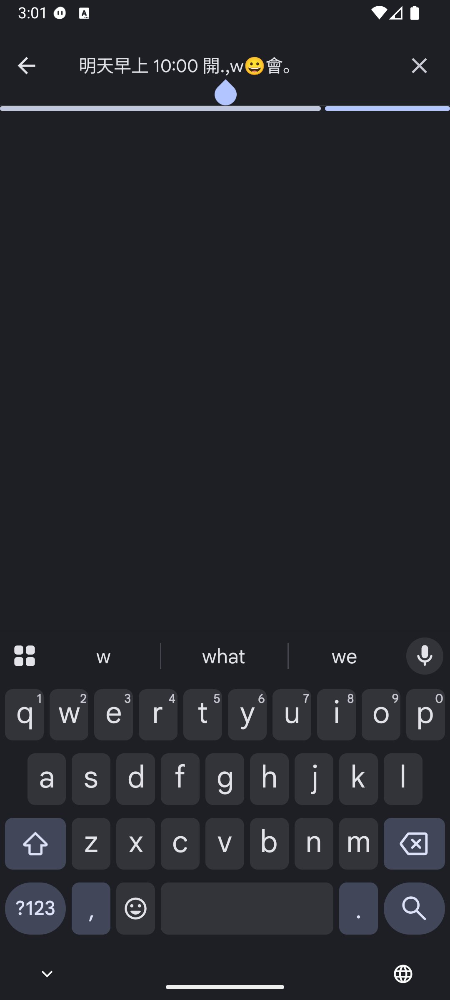
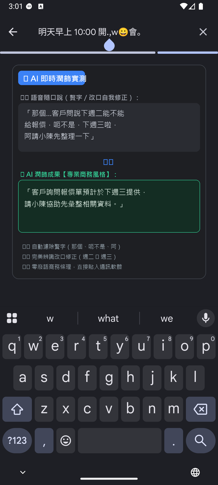
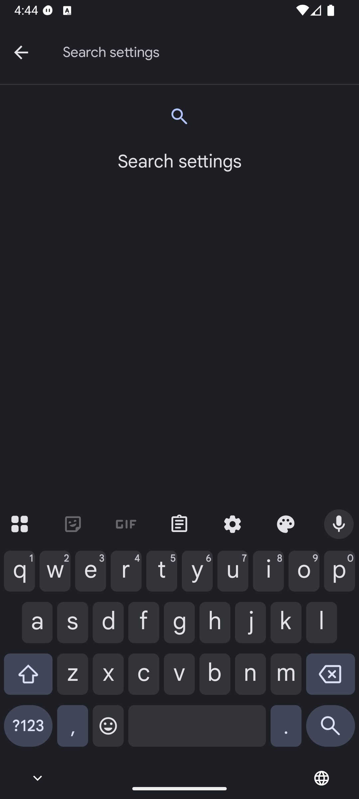

# FlowChat (語音智慧輸入法)

[English](#english) | [繁體中文](#繁體中文)

---

## 繁體中文

FlowChat 是一款基於語音辨識與大語言模型（LLM）的 Android 智慧鍵盤（IME）。具備超低延遲語音轉文字、多風格 AI 潤飾、雙軌防爆額（429 Fallback）、對稱鍵盤佈局、剪貼簿管理與 Emoji 面板。

### 📸 介面與實戰效果展示

| 1. 主鍵盤介面 | 2. 隨口說 ➔ AI 完美潤飾實測 | 3. 語氣情境快速切換 |
| :---: | :---: | :---: |
|  |  |  |
| 對稱底列、麥克風操作列與狀態提示 | 贅字過濾、自動辨識改口自我修正 | 基礎／專業／高情商／幽默 4 大語氣 |

---

### 🌟 核心特色

1. **模組化 AI 潤飾 (Base + Addon Architecture)**
   - **基礎整理 (Basic)**：去贅字、修標點、自我修正辨識，原汁原味。
   - **專業潤飾 (Professional)**：清楚成熟的商務訊息表達，條理分明。
   - **高情商聊天 (EQ Chat)**：溫暖體貼，化解生硬或尷尬對話。
   - **幽默聊天 (Humor Chat)**：風趣有梗，自然自嘲與俏皮互動。
   - **長度偏好微調**：支援精簡（Concise）、標準（Standard）、充實（Elaborate）。
2. **雙軌 429 備援機制**
   - 遭遇速率限制（HTTP 429）時，自動依序切換「備用金鑰」與「備用模型」，確保輸入流程不中斷。
3. **優化鍵盤佈局與效率工具**
   - 底部全對稱操作列（切換｜😊｜空白｜。｜Enter）。
   - 頂部導航列標準化，整合 Emoji 與 剪貼簿紀錄。
   - 支援離線暫存與敏感內容遮罩（密碼、金鑰、卡號保護）。

### 🚀 快速上手 (Groq 設定)

FlowChat 推薦搭配 [Groq](https://console.groq.com/) 達到極速轉錄與潤飾：

1. 前往 [Groq Console](https://console.groq.com/keys) 免費建立 API Key。
2. 下載並安裝 FlowChat APK。
3. 在系統設定中啟用 FlowChat 鍵盤，並前往 FlowChat 設定頁：
   - **語音辨識 (STT)**：
     - 端點：`https://api.groq.com/openai/v1/audio/transcriptions`
     - 模型：`whisper-large-v3-turbo`
     - API Key：貼上您的 `gsk_...` 金鑰
   - **AI 潤飾 (LLM)**：
     - 端點：`https://api.groq.com/openai/v1/chat/completions`
     - 模型：`llama-3.3-70b-versatile`（可選備用模型例如 `openai/gpt-oss-20b`）
     - API Key：留空將自動沿用語音辨識 Key，亦可填寫不同帳號之備用金鑰。

### 📲 下載安裝

請至 [GitHub Releases](https://github.com/kairosvector/flowchat/releases) 下載最新版 APK 直接安裝。

### 🛠️ 未來發展與歡迎協作 (Roadmap)
- [ ] 支援本地離線語音模型 (On-Device Whisper / Vosk)
- [ ] 支援使用者完全自訂 Prompt 與社群語氣匯入
- [ ] Material You 動態色彩主題支援

### 📄 授權條款

本專案基於 GPL-3.0 授權開源。本專案衍生自 [j3soon/whisper-to-input](https://github.com/j3soon/whisper-to-input)。

---

## English

FlowChat is an intelligent voice input keyboard (IME) for Android powered by Speech-to-Text (STT) and LLMs. It features ultra-low latency transcription, modular tone polishers, dual-track 429 rate-limit fallback, symmetric keyboard layouts, clipboard manager, and an emoji picker.

### 📸 Showcase

| 1. Main Keyboard | 2. Instant Speech-to-Polished Test | 3. Tone Switcher |
| :---: | :---: | :---: |
|  |  |  |

### 🌟 Key Features

1. **Modular AI Polishing (Base + Addon Architecture)**
   - **Basic Cleanup**: Removes filler words, fixes typos/punctuation, preserves original intent verbatim.
   - **Professional**: Business-appropriate, clear, and well-structured messaging.
   - **High-EQ Chat**: Warm, considerate, and empathetic communication.
   - **Humorous Chat**: Witty, charming, and playful interactions.
   - **Length Modifier**: Fine-tune length with Concise, Standard, or Elaborate styles.
2. **Dual-Track 429 Fallback**
   - Automatically switches between fallback API keys and fallback models upon encountering rate limits (HTTP 429).
3. **Ergonomic Layout & Productivity**
   - Symmetric bottom row (`[Switch]` `[😊]` `[Space]` `[。]` `[Enter]`).
   - Standardized top navigation bar with quick Emoji & Clipboard panel.
   - Sensitive text masking (passwords, auth keys, cards).

### 🚀 Quick Start (Groq Configuration)

1. Obtain a free API key from [Groq Console](https://console.groq.com/keys).
2. Install the FlowChat APK and enable it in Android System Settings.
3. In FlowChat Settings:
   - **STT Endpoint**: `https://api.groq.com/openai/v1/audio/transcriptions`
   - **STT Model**: `whisper-large-v3-turbo`
   - **STT Key**: Enter your `gsk_...` key
   - **AI Endpoint**: `https://api.groq.com/openai/v1/chat/completions`
   - **AI Model**: `llama-3.3-70b-versatile` (Fallback: e.g., `openai/gpt-oss-20b`)

### 📲 Download

Download the APK from [GitHub Releases](https://github.com/kairosvector/flowchat/releases).

### 📄 License

Licensed under the GNU General Public License v3.0 (GPL-3.0). Forked and evolved from [j3soon/whisper-to-input](https://github.com/j3soon/whisper-to-input).
